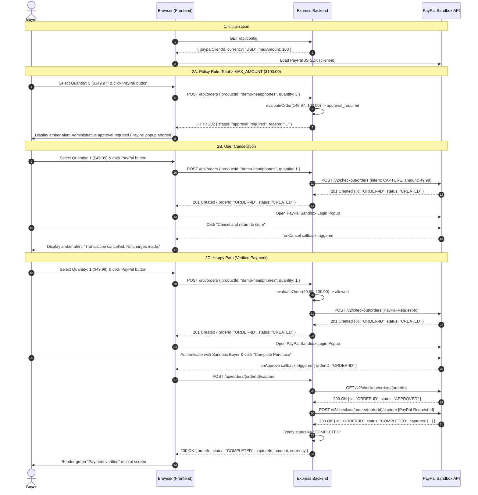

# PayPilot Checkout

PayPilot Checkout is a lightweight, secure web application demonstrating a complete server-side integration of the **PayPal Orders v2 REST API** in sandbox mode. Built with Node.js, Express, and TypeScript, it implements an authoritative payment model where the browser never handles client secrets and never makes authoritative decisions on payment success.

> **Notice**: This project operates strictly in **PayPal Sandbox mode** using hardcoded demo catalog data. No real financial transactions occur.

---

## Features

- **Authoritative Server Pricing**: Features a demo product catalog (*Demo Wireless Headphones*, $49.99 USD). The server looks up prices authoritatively and completely ignores any client-submitted pricing.
- **Automated Server-Side Approval Policy**: Evaluates order totals against a configurable threshold (`MAX_AMOUNT`, default $100.00 USD). Orders exceeding this limit return `HTTP 202 Accepted` with a structured `approval_required` decision and abort the PayPal popup.
- **Server-Side Verified Capture**: Payment capture is executed and verified exclusively by the backend. The frontend displays "Payment verified" **only** when PayPal confirms `status: "COMPLETED"`.
- **Pre-Approval Enforcement**: Enforces that orders must have an `APPROVED` status before capture can be attempted, preventing race conditions or fraudulent client claims.
- **Strict Idempotency**: Automatically attaches `PayPal-Request-Id` headers to all state-mutating requests (`create` and `capture`) to prevent duplicate transactions on network retries.
- **Resilient Error Handling**: Centralized error mapping guarantees consistent JSON responses (`{ error: { code, message } }`) with no stack traces or credentials exposed. Outbound PayPal requests are protected by a 10-second timeout.

---

## Architecture

The following sequence diagram illustrates the complete checkout lifecycle, including the happy path, server approval blocking, and cancellation.



---

## Tech Stack

- **Runtime & Language**: Node.js (v18+) with TypeScript (strict mode)
- **Web Framework**: Express v4
- **Schema Validation**: Zod (for environment variables and route request payloads)
- **Environment Management**: dotenv
- **Testing**: Vitest
- **External Integration**: PayPal Orders v2 REST API (Sandbox) & PayPal JavaScript SDK

---

## Setup & Installation

### Prerequisites
- [Node.js](https://nodejs.org/) (v18.0.0 or higher recommended)
- [npm](https://www.npmjs.com/) (v9.0.0 or higher)
- A [PayPal Developer](https://developer.paypal.com/) account

### 1. PayPal Sandbox Account Setup
1. Log in to the [PayPal Developer Dashboard](https://developer.paypal.com/dashboard/).
2. Under **Apps & Credentials**, toggle to **Sandbox** and select or create an app to obtain:
   - **Client ID**
   - **Secret**
3. Under **Testing Tools > Sandbox Accounts**, note your auto-generated **Personal (Buyer)** account credentials (`email` and `password`) to use during checkout.

### 2. Configure Environment Variables
Copy `.env.example` to `.env`:
```bash
cp .env.example .env
```

Configure your `.env` file:
```env
PAYPAL_CLIENT_ID=your_paypal_sandbox_client_id
PAYPAL_CLIENT_SECRET=your_paypal_sandbox_client_secret
PAYPAL_ENV=sandbox
MAX_AMOUNT=100
PORT=3000
```

> **Security Note**: Never commit `.env` or expose `PAYPAL_CLIENT_SECRET`. `.env` is ignored by `.gitignore`.

### 3. Install Dependencies
```bash
npm install
```

---

## Running the Application

### Development Mode
Runs the TypeScript compiler and launches the server:
```bash
npm run dev
```

### Production Build & Execution
```bash
# Compile TypeScript to dist/
npm run build

# Start compiled server
npm start
```

Once running, navigate to:
```
http://localhost:3000
```

---

## Testing

### Automated Test Suite
Runs the Vitest test suite covering approval policy boundaries, catalog price enforcement, pre-approval capture rejections (409), verified capture validations, and public configuration security:
```bash
npm test
```

### Manual Sandbox Payment Walkthrough

1. **Happy Path ($49.99 USD)**:
   - Keep quantity at `1` ($49.99).
   - Click the yellow **PayPal Checkout** button.
   - In the popup, log in with your sandbox buyer credentials.
   - Click **Complete Purchase**.
   - Observe the green **Payment verified** screen displaying the capture ID and amount.

2. **Above-Limit Case (Approval Rule)**:
   - Change quantity to `3` ($149.97).
   - Click **PayPal Checkout**.
   - Notice the PayPal popup does not open; an amber notification informs you that the transaction exceeds the $100 limit.

3. **User Cancellation**:
   - Change quantity to `1`.
   - Click **PayPal Checkout**.
   - In the popup, click **Cancel and return to test store** or close the window.
   - Notice the amber notification indicating cancellation with no charge.

---

## Security Design

1. **Zero Secret Exposure**:
   - `PAYPAL_CLIENT_SECRET` is used exclusively on the server to negotiate short-lived bearer tokens via HTTP Basic Auth.
   - The `/api/config` endpoint and client files receive only the public `PAYPAL_CLIENT_ID`.
2. **Authoritative Server Pricing**:
   - The browser sends `{ productId, quantity }`.
   - The server computes `product.price * quantity` from internal records. Any client-submitted `price` or `amount` is stripped and ignored.
3. **Zero Trust in Client Payment Status**:
   - The backend validates the order status directly with PayPal (`GET /v2/checkout/orders/{id}`) to ensure status is `APPROVED` before initiating capture.
   - Frontend renders the success view only when the backend capture response confirms `status: "COMPLETED"`.
4. **Idempotency**:
   - Every mutating PayPal call (`create` and `capture`) attaches a unique `PayPal-Request-Id` UUID, preventing duplicate charges upon network timeouts or browser retries.
5. **No Stack Traces in Responses**:
   - Centralized error handlers strip internal error stacks and map application errors into sanitized `{ error: { code, message } }` objects.

---

## Known Limitations

- **Sandbox Only**: Configured explicitly for `https://api-m.sandbox.paypal.com`. Production credentials are deliberately rejected.
- **Single Demo Product**: The catalog in `src/data/products.ts` contains one demo SKU.
- **Synchronous Policy Blocking**: The approval rule blocks transactions over `$100.00` immediately rather than enrolling them in an asynchronous administrative review workflow.
- **Stateless In-Memory Storage**: There is no database; order IDs and tokens are not persisted across server restarts.
- **No Webhooks**: Relies on synchronous API responses rather than asynchronous event webhooks.

---

## Next Steps for Production Hardening

1. **Webhook Signature Verification**: Add a listener for `PAYMENT.CAPTURE.COMPLETED` and `CHECKOUT.ORDER.APPROVED` using PayPal's `/v1/notifications/verify-webhook-signature` for asynchronous fulfillment.
2. **Database Persistence**: Integrate PostgreSQL or MongoDB to record orders, customer records, and transaction logs.
3. **Automated Retries**: Implement exponential backoff for transient 5xx errors or network timeouts when contacting PayPal.
4. **Multi-Currency Support**: Expand catalog and approval policies to handle multi-currency conversions and localized PayPal payment methods.
5. **Production Vaulting / Subscriptions**: Integrate PayPal Vault and Recurring Billing for saved payment methods.

