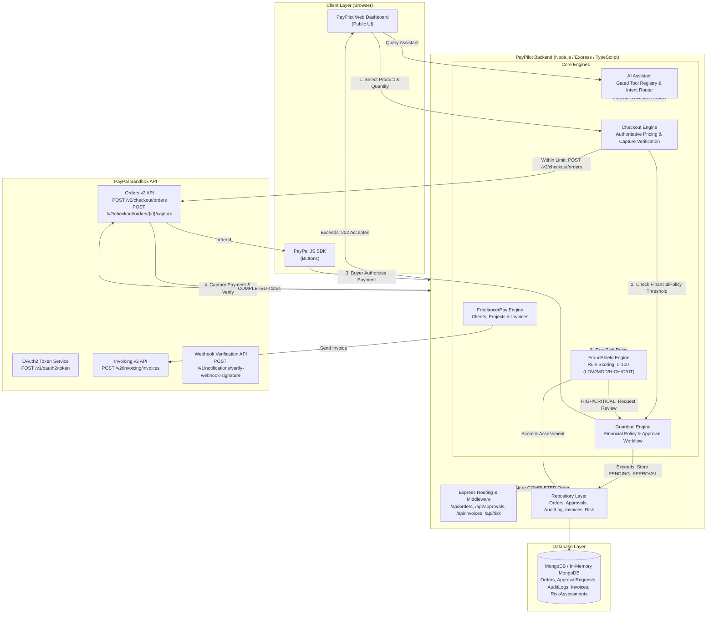

# PayPilot Checkout

PayPilot Checkout is an authoritative, policy-governed payment gateway and financial operations engine demonstrating a production-grade server-side integration of the **PayPal Orders v2** and **Invoicing v2** REST APIs in sandbox mode.

Built with Node.js, Express, TypeScript, and MongoDB, PayPilot solves the core security and operational flaws common in naive payment integrations:
1. **Client-Side Price Tampering**: PayPilot enforces authoritative server pricing from catalog data, stripping and ignoring client-supplied amounts.
2. **Unverified Payment Captures**: Payment status is never determined by the browser. Captures are executed and verified strictly on the backend, and status is reconciled upon network timeout.
3. **Lack of Internal Financial Governance**: The **Guardian** engine blocks transactions exceeding financial policy thresholds until an administrator approves them.
4. **Blind Risk**: The **FraudShield** engine analyzes incoming orders using local heuristics, scoring risk from 0 to 100 and routing suspicious orders to Guardian review.
5. **Operational Complexity**: An **AI Assistant** enables conversational management of transactions, approvals, invoices, and risk assessments through a strictly gated tool registry.

> **Notice**: This project operates strictly in **PayPal Sandbox mode** (`https://api-m.sandbox.paypal.com`). No real financial transactions occur.

---

## Module Status Overview

| Module | Status | Notes |
| :--- | :--- | :--- |
| **Checkout (Orders v2)** | **Implemented** | Authoritative catalog pricing, verified capture, idempotency keys, and capture timeout reconciliation. |
| **Guardian Approval Engine** | **Implemented** | Policy evaluation (`FinancialPolicy`), persistent `ApprovalRequest`, immutable `AuditLog`, 403 rejection, and 409 conflict protection. |
| **PayPilot Transactions** | **Implemented** | Stored order transactions and monthly summary aggregated strictly from local database records (no external transaction search). |
| **FraudShield Risk Engine** | **Implemented** | Pure rule functions (spike, velocity, midnight hours, repeated failures, currency), 0–100 scoring, and automatic Guardian escalation for HIGH/CRITICAL. |
| **FreelancerPay Invoicing** | **Implemented** | Local client/project management, server-computed line item totals, overdue batch marking, and live **PayPal Invoicing v2** draft creation. |
| **AI Assistant** | **Implemented** | Deterministic regex intent routing with clarifying questions, safety refusals, optional Gemini LLM parsing (`GEMINI_API_KEY`), and `AuditLog` logging. |
| **PayPal Invoicing API** | **Live Sandbox Verified** | Invoicing v2 API probed and verified with live sandbox scope (`HTTP 201 Created`, invoice ID returned). |
| **Webhook Verification** | **Implemented** | Mounted before `express.json()`, raw body cryptographic signature verification via PayPal API, and duplicate event deduplication. |

---

## Architecture Diagram



---

## Project Modules

### 1. Checkout (PayPal Orders v2)
- **Authoritative Pricing**: Demo catalog (`src/data/products.ts`) defines items and prices. Client requests only specify `{ productId, quantity, checkoutAttemptId }`. Client-provided prices are ignored.
- **Pre-Approval Gate**: Orders must have an `APPROVED` status before capture can be initiated, preventing race conditions or fraudulent claims.
- **Verified Capture**: `POST /api/orders/:id/capture` verifies the capture directly with PayPal. The frontend displays "Payment verified" **only** when PayPal returns `status: "COMPLETED"`.
- **Idempotency & Timeout Reconciliation**: Every mutating call passes a unique `PayPal-Request-Id`. If a capture call times out, the backend automatically queries `GET /v2/checkout/orders/{id}` to reconcile status without double-charging.

### 2. Guardian Policy Engine
- **FinancialPolicy**: Defines rules such as `requiresApprovalAbove` (default: $100.00 USD).
- **Approval Workflow**: Orders or invoices exceeding the threshold are intercepted and marked `PENDING_APPROVAL`. An `ApprovalRequest` is created and an `AuditLog` row is recorded.
- **Administrative Review**: Exposes `GET /api/approvals`, `POST /api/approvals/:id/approve`, and `POST /api/approvals/:id/reject`.
- **Zero-Bypass Security**: An approved order transitions to `APPROVED` locally. It never calls PayPal automatically—only the buyer can complete checkout.

### 3. PayPilot Transactions
- **Local Source of Truth**: Serves transaction history via `GET /api/transactions` and monthly volume/count summaries via `GET /api/transactions/summary`.
- **Independent Aggregation**: Aggregates directly from local MongoDB order records without calling PayPal's Transaction Search API.

### 4. FraudShield Risk Engine
- **Pure Rule Functions**: Evaluates 5 pure rules without external dependencies:
  1. `checkAmountSpike`: Flags amounts $> 2\times$ the historical completed average.
  2. `checkOrderVelocity`: Flags $> 3$ orders in 10 minutes.
  3. `checkMidnightHours`: Flags orders placed between 00:00 and 05:00 local time.
  4. `checkRepeatedFailures`: Flags $\ge 2$ failed/cancelled orders in the last hour.
  5. `checkNonUsdCurrency`: Flags non-USD currencies.
- **Classification**: Scores from 0 to 100 mapped to `LOW` (0–29), `MODERATE` (30–59), `HIGH` (60–79), and `CRITICAL` (80–100).
- **Guardian Escalation**: High/Critical orders trigger a Guardian `ApprovalRequest` without blocking checkout on score alone.
- **Disclaimer**: Labeled explicitly: *"Local rule-based assessment. Not a PayPal fraud verdict."*

### 5. FreelancerPay Invoicing
- **Data Model**: Mongoose models for `Client`, `Project`, and `Invoice`.
- **Authoritative Totals**: Invoices calculate `total` on the server from `items [{ description, quantity, unitPrice }]`.
- **Policy Enforcement**: Invoices exceeding the active policy threshold are held in `DRAFT` and cannot be sent until approved in Guardian (`HTTP 403 INVOICE_APPROVAL_REQUIRED`).
- **PayPal Invoicing v2 Integration**: Sending an approved invoice calls PayPal Invoicing v2 (`POST /v2/invoicing/invoices`), saving `paypalInvoiceId` and updating status to `SENT`.
- **Overdue Detection**: `POST /api/invoices/mark-overdue` transitions past-due `SENT` invoices to `OVERDUE` based on stored records.

### 6. AI Assistant
- **Strictly Gated Tool Registry**: Exposes 7 read tools and 2 write tools (`createInvoiceDraft`, `requestOrderApproval`). Strictly excludes `approve`, `reject`, `capture`, or direct PayPal API calls.
- **Deterministic Intent Router**: Regex pattern matching for common queries with clarifying questions when amounts, clients, or IDs are missing.
- **Optional Gemini LLM Parsing**: If `GEMINI_API_KEY` is provided, user prompts are parsed into tool arguments and validated with Zod. If the model returns an invalid tool or schema, execution safely falls back to the deterministic router.
- **Audit Logging**: Every tool execution is recorded in the immutable `AuditLog`.

---

## Setup & Installation

### Prerequisites
- Node.js (v18.0.0 or higher)
- npm (v9.0.0 or higher)
- PayPal Developer Sandbox Account ([developer.paypal.com](https://developer.paypal.com))

### 1. Clone & Install Dependencies
```bash
cd paypilot-checkout
npm install
```

### 2. Configure Environment Variables
Copy `.env.example` to `.env`:
```bash
cp .env.example .env
```
Update `.env` with your PayPal Sandbox credentials:
```env
PAYPAL_CLIENT_ID=your_paypal_sandbox_client_id
PAYPAL_CLIENT_SECRET=your_paypal_sandbox_client_secret
PAYPAL_ENV=sandbox
MAX_AMOUNT=100
PORT=3000
MONGODB_URI=mongodb://127.0.0.1:27017/paypilot_checkout
PAYPAL_WEBHOOK_ID=your_webhook_id_here
GEMINI_API_KEY=your_gemini_api_key_here
```
> **Note**: If a local MongoDB instance is not reachable, PayPilot automatically spins up an in-memory MongoDB server (`mongodb-memory-server`) for zero-configuration local development.

### 3. Build & Run
```bash
# Build TypeScript
npm run build

# Start application
npm start
```
Navigate to `http://localhost:3000` in your browser.

---

## Testing & Verification

### Running the Test Suite
The test suite contains 73 automated tests covering policy boundaries, verified capture, idempotency, webhook signature verification, FraudShield scoring, FreelancerPay rules, and the AI Assistant:
```bash
npm test
```

### Manual Sandbox Checkout Walkthrough
1. **Automated Approval Path ($\le \$100.00$)**:
   - Set Quantity to `1` ($49.99).
   - Click **PayPal Checkout**.
   - Log in with your PayPal Sandbox Personal account.
   - Click **Complete Purchase**.
   - Observe the green **Payment verified** screen displaying the capture ID and amount.
2. **Guardian Policy Gating Path ($> \$100.00$)**:
   - Set Quantity to `3` ($149.97).
   - Click **PayPal Checkout**.
   - The PayPal popup does not open; an amber notification informs you that administrative approval is required.
   - Navigate to the **Guardian Policy & Approval Engine** section.
   - Click **Approve** on the pending request.
   - Return to the product card and click **PayPal Checkout**; checkout now proceeds to PayPal successfully.
3. **Transaction Cancellation**:
   - Click **PayPal Checkout** with quantity `1`.
   - In the popup, click **Cancel and return to test store**.
   - Observe the cancellation message: *"PayPal transaction was cancelled. No charges were made."*

### Webhook Tunnel Setup (Live Webhooks)
To test live asynchronous webhooks from PayPal Sandbox:
1. **Start ngrok tunnel**:
   ```bash
   ngrok http 3000
   ```
2. **Register Webhook in PayPal Developer Dashboard**:
   - Log in to [developer.paypal.com](https://developer.paypal.com) -> Apps & Credentials -> Your Sandbox App.
   - Add Webhook: `https://<your-ngrok-subdomain>.ngrok-free.app/api/webhooks/paypal`
   - Select events: `Payment capture completed`, `Checkout order approved`.
   - Copy the generated Webhook ID and set `PAYPAL_WEBHOOK_ID=<id>` in `.env`.
3. **Trigger Webhook**:
   - Complete a sandbox purchase.
   - Inspect backend logs for `[Webhook Signature Verified: SUCCESS]` and database update confirmation.

---

## Known Limitations

- **Sandbox Environment Only**: Hardcoded to `https://api-m.sandbox.paypal.com`. Live production credentials cannot be used without explicit architectural changes.
- **Local Database Persistence**: Built for single-instance MongoDB or in-memory MongoDB fallback. Multi-region clustering, sharding, and database replication are not configured.
- **No User Authentication / RBAC**: Administrative endpoints (`/api/approvals`, `/api/audit`, `/api/transactions`, `/api/invoices`) are open for evaluation purposes. Production requires JWT/session authentication and role-based permissions.
- **Rule-Based Fraud Scoring**: FraudShield uses local statistical heuristics (velocity, order spikes, midnight hours). It does not integrate external credit bureaus, machine learning models, or PayPal Fraud Protection verdicts.
- **Single Catalog Product**: Checkout catalog currently contains one demo product SKU (*Demo Wireless Headphones*).
- **Assistant Scope**: The AI Assistant is a targeted tool intent router for PayPilot backend services, not an open-ended conversational chatbot.

---

## Roadmap (Master Spec Enhancements)

- [ ] **React / Next.js Admin Dashboard**: Replace server-served vanilla JS frontend with a modern, reactive dashboard with real-time WebSocket updates.
- [ ] **User Authentication & RBAC**: Implement OAuth2 / JWT authentication with defined roles: `Admin`, `Compliance Officer`, `Freelancer`, and `Buyer`.
- [ ] **PayPal Payouts Integration**: Add PayPal Payouts API support for automated batch freelancer disbursements upon invoice payment.
- [ ] **Multi-Tenant Architecture**: Add merchant account isolation and individual API credential management for multi-vendor platforms.
- [ ] **Cloud Containerization & Deployment**: Provide Dockerfile, Docker Compose, and Helm charts for Google Cloud Run / AWS ECS deployment.
- [ ] **Unified Five-Engine UI**: Deliver an integrated operations dashboard uniting Checkout, Guardian, Transactions, FraudShield, and FreelancerPay.
